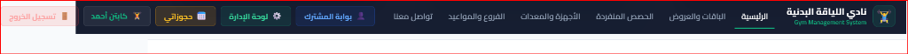

<div dir="rtl">

# نظام إدارة النادي الرياضي (Gym Client & Demo Backend)

> تطبيق ويب متكامل لإدارة الصالات الرياضية والاشتراكات، وحجز الحصص التدريبية، مع لوحة متابعة للمشتركين ولوحة تحكم للإدارة.

---

## 🔗 روابط المنصة المنشورة (Live Demo)

التطبيق منشور ومتاح للمعاينة على Vercel عبر الروابط التالية:
* **الرابط الأساسي (الموصى به)**: [https://gym-project-blond-one.vercel.app](https://gym-project-blond-one.vercel.app)
* **رابط المعاينة البديل**: [https://gym-project-vgp1.vercel.app](https://gym-project-vgp1.vercel.app)

*(ملاحظة: عند النشر على منصات الاستضافة السحابية الثابتة، يعتمد التطبيق على محرك المحاكاة المحلي المدمج Mock Fallback لتوفير تجربة تفاعلية كاملة).*

---

## 📸 لقطات من النظام (Screenshots)

| الشاشة | المعاينة |
| :--- | :--- |
| **بوابة المشترك والحجوزات** |  |
| **شريط التنقل المتجاوب (RTL)** |  |
| **جلسة المشترك وتأكيد الحجز** |  |

---

## 🔑 بيانات الدخول التجريبية (Demo Credentials)

> ⚠️ **تنبيه هام**: هذه البيانات مخصصة لأغراض العرض والتجربة فقط (Demonstration Only). في أي بيئة تشغيلية حقيقية، يلزم تشفير كلمات المرور باستخدام خوارزميات التجزئة الآمنة (مثل bcrypt أو argon2) واستخدام مصادقة موثوقة تعتمد على رموز الدخول وقواعد بيانات مركزية.

| الصلاحية | اسم المستخدم | كلمة المرور | الصفحة الافتراضية |
| :--- | :--- | :--- | :--- |
| **مدير النظام (Admin)** | `manager` أو `admin` | `gym@2026` أو `123` | لوحة الإدارة (`/admin-dashboard`) |
| **المشترك (Member)** | `captain.ahmed` أو `member` | `gym@2026` أو `123` | بوابة المشترك (`/member-portal`) وحجوزاتي |

---

## ⚙️ معمارية التطبيق وطريقة العمل

1. **الوضع التجريبي الاحتياطي (Mock Fallback)**:
   - يتصل التطبيق بنقاط النهاية `/api/*`.
   - في حالة عدم تشغيل الخادم الخلفي (مثل الاستضافة كصفحة ثابتة)، يعترض الـ HTTP Interceptor الطلبات ويحوّلها فوراً لقاعدة بيانات محلية في المتصفح (`mock-gym.db.ts`) لتبقى الواجهة تفاعلية بالكامل.
2. **سلاسة الحجز للمستخدم الجديد**:
   - إذا اختار زائر حصة قبل تسجيل الدخول، تُحفظ تفاصيل الحصة في المتصفح، وبمجرد تسجيل دخوله تفتح له نافذة "تأكيد الحجز" فوراً لتثبيت مقعده.
3. **تحديث الحجوزات محلياً**:
   - حجز وإلغاء الحصص يحدّث المقاعد والحساب الحالي لدى المستخدم محلياً في المتصفح.

---

## ⚠️ القيود التقنية المعروفة (Known Limitations)

* **ملف البيانات المحلي (JSON Store)**: يعتمد الخادم التوضيحي المرفق على ملف JSON محلي (`server/database.json`). هذا الأسلوب مناسب فقط للعرض والتطوير ولا يصلح لبيئات الإنتاج الفعلية.
* **استضافة Vercel بدون خادم (Serverless Read-Only Filesystem)**: نظام الملفات في وظائف Serverless على Vercel مؤقت وللقراءة فقط، لذا لا يمكن حفظ تعديلات دائمة على ملفات الخادم محلياً، ويلزم ربط قاعدة بيانات سحابية خارجية (مثل PostgreSQL أو MongoDB) للاحتفاظ بالبيانات.
* **بوابات الدفع الإلكتروني**: النظام حالياً **مجهز وقابل للربط** مستقبلاً مع بوابات الدفع (مثل Paymob أو Stripe أو Fawry)، ولم تُدمج هذه البوابات كمعاملات دفع حية بعد.

---

## 🛠️ متطلبات التشغيل والتقنيات

* **بيئة التشغيل**: Node.js الإصدار `20.18.0` أو أعلى (يوصى بـ `22.x`، انظر ملف `.nvmrc`).
* **إطار العمل**: Angular `22.1.0` (Angular CLI `22.1.8`).
* **لغة البرمجة**: TypeScript `~6.0.2`.
* **مكتبة الاختبارات**: Vitest `^4.0.8`.
* **الخادم التوضيحي**: Express.js مع التحقق من صحة البيانات باستخدام Zod.

---

## 💻 التشغيل على جهازك (Local Development)

### 1. تثبيت الحزم:
```bash
npm install
```

### 2. طرق التشغيل:

* **الخيار الأول: تشغيل الواجهة فقط بالوضع الاحتياطي (الأسهل والأسرع)**:
  ```bash
  npm start
  ```
  يعمل على `http://localhost:4200/` مع تفعيل الـ Mock Fallback تلقائياً.

* **الخيار الثاني: تشغيل الواجهة مع الخادم التجريبي معاً**:
  افتح نافذتي Terminal:
  ```bash
  # النافذة 1: تشغيل السيرفر التجريبي
  npm run server

  # النافذة 2: تشغيل الواجهة وتمرير الطلبات عبر الـ Proxy
  npm start
  ```
  يقوم ملف `proxy.conf.json` بتحويل جميع طلبات `/api` من المنفذ 4200 إلى المنفذ 3000.

### 3. تشغيل الاختبارات الآلية:
```bash
npm test -- --watch=false
```

### 4. بناء نسخة الإنتاج:
```bash
npm run build
```

---

## 🗺️ خطة التطوير المستقبلية (Roadmap)

- [ ] ربط قاعدة بيانات علائقية سحابية (PostgreSQL مع Prisma ORM).
- [ ] إضافة مصادقة أمنية قائمة على JWT وتشفير كلمات المرور.
- [ ] دعم الربط المباشر مع بوابات الدفع الإلكتروني المحلية والدولية.
- [ ] تصدير كشوف الحسابات والحضور إلى ملفات PDF و Excel.

---

## 📄 الترخيص (License)

هذا المشروع مرخص ومتاح للاستخدام وفق رخصة مفتوحة المصدر، انظر ملف [LICENSE](LICENSE).

</div>
