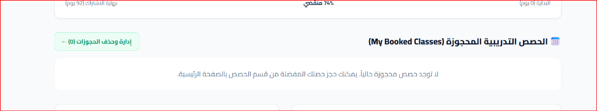
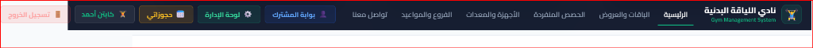
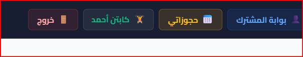

# Gym Management System (Frontend & Demo API)

> Modern gym and sports club management web client built with Angular and an Express demo API.

---

## 🔗 Live Demo & Deployment Links

The project is hosted on Vercel:
* **Primary Live URL (Recommended)**: [https://gym-project-blond-one.vercel.app](https://gym-project-blond-one.vercel.app)
* **Alternative Preview URL**: [https://gym-project-vgp1.vercel.app](https://gym-project-vgp1.vercel.app)

*(Note: When deployed as a static client on serverless platforms, runtime requests fallback gracefully to the integrated client-side mock store).*

---

## 📸 Screenshots

| View | Screenshot |
| :--- | :--- |
| **Member Portal & Bookings** |  |
| **Responsive Navigation** |  |
| **Active Session State** |  |

---

## 🔑 Demo Access Credentials

> **Notice**: These credentials exist solely for demonstration and UI testing purposes. In a real-world deployment, all user accounts require secure authentication protocols, salted hashing (e.g., argon2/bcrypt), and role-based database storage.

| Role | Username | Password | Intended Screen / Route |
| :--- | :--- | :--- | :--- |
| **System Admin** | `manager` or `admin` | `gym@2026` or `123` | Redirects directly to `/admin-dashboard` |
| **Club Member** | `captain.ahmed` or `member` | `gym@2026` or `123` | Redirects to `/member-portal` & `/my-bookings` |

---

## ⚙️ Key Architectural Concepts

1. **Client-Side Fallback Store (Mock DB Fallback)**:
   - The app communicates with `/api/*` endpoints.
   - If the Express server is offline or the front-end is served statically, an Angular HTTP Interceptor (`mock-api.interceptor.ts`) intercepts failing requests and routes them to an in-memory client store (`mock-gym.db.ts`).
2. **Session Booking State Preservation**:
   - If a guest user clicks "Book Session" from the home screen, the target session is recorded in `sessionStorage`. Once authenticated, the booking confirmation modal re-opens automatically for immediate confirmation.
3. **Local Scope Seat Management**:
   - Booking and cancellation update the current client state and stored mock entries locally.

---

## ⚠️ Known Limitations

* **File-Based JSON Storage**: The local Express server uses a single JSON file (`server/database.json`). This is designed for local demonstration and is not suitable for concurrent production database loads.
* **Serverless Read-Only Filesystems**: On serverless hosts like Vercel, serverless function filesystems are ephemeral and read-only; persistent writes require an external database service (e.g., PostgreSQL, MongoDB).
* **Payment Gateways**: Third-party payment gateways (such as Stripe, Paymob, or Fawry) are not integrated in this codebase; the architecture is structured to allow future payment webhook integrations.

---

## 🛠️ Tech Stack & Requirements

* **Runtime**: Node.js `>= 20.18.0` (Recommended: `22.x` LTS, see `.nvmrc`)
* **Framework**: Angular `22.1.0` (Angular CLI `22.1.8`)
* **TypeScript**: `~6.0.2`
* **Test Runner**: Vitest `^4.0.8` (configured via `@angular/build:unit-test`)
* **Backend**: Express.js with Zod payload validation

---

## 💻 Local Development Setup

### 1. Prerequisites
Ensure you are using a compatible Node.js version:
```bash
nvm use || node -v
```

### 2. Installation
```bash
npm install
```

### 3. Running the Application
The project can be run in two modes:

* **Mode A: Frontend with integrated Mock fallback (Standard)**
  ```bash
  npm start
  ```
  Runs on `http://localhost:4200/`. When the backend is not running, the HTTP interceptor automatically provides mock responses.

* **Mode B: Full-stack (Frontend + Express API Server)**
  Open two terminal windows:
  ```bash
  # Terminal 1: Backend Server (runs on port 3000)
  npm run server

  # Terminal 2: Frontend with proxy (configured via proxy.conf.json)
  npm start
  ```
  The proxy forwards `/api/*` requests from port 4200 directly to `http://localhost:3000`.

### 4. Running Unit Tests
```bash
npm test -- --watch=false
```

### 5. Production Build
```bash
npm run build
```
Build artifacts are placed in `dist/GymClient`.

---

## 🗺️ Roadmap

- [ ] Connect a persistent SQL database (e.g., PostgreSQL / Prisma ORM).
- [ ] Integrate JWT authentication with password encryption.
- [ ] Implement online payment checkout hooks.
- [ ] Export member attendance and subscription reports to PDF/Excel.

---

## 📄 License & Arabic Documentation

* Standard open license: see [LICENSE](LICENSE).
* النسخة العربية من التوثيق متاحة في: [README.ar.md](README.ar.md).
